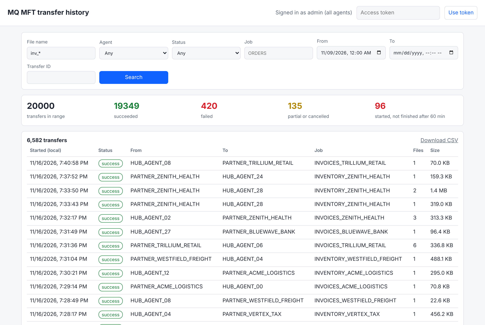
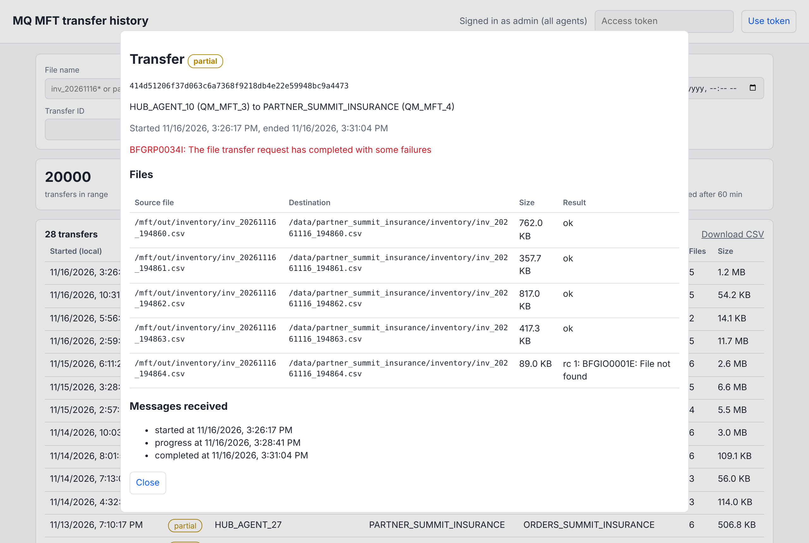

# mqmft-transfer-history

**A searchable transfer history and self service lookup for IBM MQ Managed File Transfer.**

Every MFT team gets the same question many times a day: *"Did my file go out?"*
MQ MFT already publishes everything needed to answer it. Each agent sends transfer log
messages to the `SYSTEM.FTE` topic on the coordination queue manager. The problem is that
nobody outside the MFT team can see them, and the live views are not built for looking
back at last Tuesday.

This project captures those messages, folds the *started*, *progress* and *completed*
messages of each transfer into one record, keeps them in a SQL database, and gives
trading partners and business users a scoped search page so they can answer the
question themselves.



## What it does

- **Collects** MQ MFT transfer log messages with a durable subscription on `SYSTEM.FTE`
  (nothing is lost while the collector restarts) or from a folder of exported XML.
- **Folds** each transfer into one row, even when messages arrive twice or out of order.
  Duplicate deliveries are detected by fingerprint. A late *started* message never
  overwrites the final per file results of a *completed* message.
- **Stores** transfers, per file results and a full message timeline in SQL. The schema is
  plain SQL and runs on SQLite out of the box. It ports to SQL Server, Db2 or PostgreSQL.
- **Serves** a JSON API and a self service web page with search by file name (wildcards),
  agent, status, job and time range, a per transfer detail view, and CSV export for audits.
- **Scopes access per token.** A partner's token only sees transfers where one of its own
  agents was the source or the destination. Only SHA-256 hashes of tokens are stored.
- **Finds stuck transfers**: started, never finished, older than N minutes.
- **Applies retention** with a single purge command.



## Quick start (five minutes, no MQ needed)

```bash
pip install git+https://github.com/prudhvi57/mqmft-transfer-history
mfthistory simulate --out msgs --transfers 20000 --days 7   # synthetic messages, 30 agents
mfthistory ingest msgs                                      # load them into mfthistory.db
mfthistory serve --no-auth                                  # open http://127.0.0.1:8080
```

Command line search works too:

```bash
mfthistory search --file "inv_*" --status failed
mfthistory stuck --minutes 60
mfthistory stats --since 2026-11-01
mfthistory show <transfer id>
```

## Running it against MQ MFT

```bash
pip install "mqmft-transfer-history[mq] @ git+https://github.com/prudhvi57/mqmft-transfer-history"
export MFTHISTORY_MQ_PASSWORD=...          # if your channel needs a user
mfthistory collect-mq --qmgr COORDQM --channel MFT.HISTORY.SVRCONN --conn "mqhost(1414)" --user mfthist
```

The collector subscribes to topic string `Log/#` under `SYSTEM.FTE` with a durable,
managed subscription and commits each message only after it is stored. See
[docs/DEPLOYMENT.md](docs/DEPLOYMENT.md) for the MQ authorities, retention planning and
moving the database to SQL Server.

Give each partner or business team its own token:

```bash
mfthistory token add --name "MFT admins" --agents "*"
mfthistory token add --name "Acme Logistics" --agents PARTNER_ACME_LOGISTICS
mfthistory serve --host 0.0.0.0 --port 8080        # put TLS / SSO in front of it
```

## How a transfer is folded

```
SYSTEM.FTE  Log/<agent>/<transfer id>
   started   ─┐
   progress  ─┼─►  parser  ─►  fingerprint (drop duplicates)  ─►  transfers        (one row)
   completed ─┘                                                   transfer_items   (one row per file)
                                                                  transfer_events  (every message)
```

| Message seen | Row status |
|---|---|
| started or progress only | `in_progress` (reported by `stuck` after the threshold) |
| completed, result code 0 | `success` |
| completed, result code 40 | `partial` (some files failed, each file keeps its own result) |
| cancelled, result code 41 | `cancelled` |
| completed, any other code | `failed` (supplement message kept, e.g. `BFGIO0001E`) |

More detail in [docs/ARCHITECTURE.md](docs/ARCHITECTURE.md).

## Performance (synthetic data)

On a small cloud VM with SQLite, the simulator's 42,773 messages for 20,000 transfers
across 30 agents (7 days) loaded in about 9 seconds, around 4,500 messages a second.
File name searches across 20,000 transfers returned in about 30 ms, and agent or status
searches in a few milliseconds. A platform that moves 500,000 files a day produces
roughly 12 to 20 messages a second on average, well inside that range. Numbers come
from synthetic data. Measure on your own hardware before sizing.

## Tests

```bash
pip install -e ".[dev]" && pytest
```

The tests cover parsing, duplicate and out of order delivery, partial results, scoped
access over HTTP, CSV export, stuck detection, retention and an end to end run over
1,500 simulated transfers.

## Scope and honesty notes

- The parser follows the MQ MFT transfer log message format that IBM documents. Field
  names and attributes can differ between MQ versions, so test with messages from your
  own agents before production. The parser skips fields it does not find instead of failing.
- All sample data is synthetic. Agent names, partners, hosts and files are invented.
- This is an independent open source project. It is not affiliated with or endorsed by IBM.
  IBM and IBM MQ are trademarks of International Business Machines Corporation.

## Related work

- [Expected Transfer Manifests](https://github.com/prudhvi57/expected-transfer-manifests):
  detecting files that never arrive. Transfer history tells you what happened; expected
  manifests tell you what should have happened and did not.

## License

Apache 2.0. See [LICENSE](LICENSE). If you use this in research, please cite it with
[CITATION.cff](CITATION.cff).
